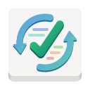

<p align="center">
  
</p>

<h1 align="center">Todav</h1>

<p align="center">Tasks and calendar for GNOME, kept in your Nextcloud.</p>

Todav is a task list and calendar app for the GNOME desktop. Your tasks and events stay in your
own Nextcloud as plain CalDAV, so the Nextcloud Tasks and Calendar web apps, DAVx⁵, Thunderbird
and other CalDAV clients keep seeing the same data. Todav adds a fast desktop app on top: it
works from a local copy, syncs in the background and picks up changes from other devices within
seconds.

## Screenshots

| Tasks, grouped by category | The month, an event's details |
| --- | --- |
|  |  |
| **The week, a time-blocked task** | **Editing an event** |
|  |  |

<p align="center">
  
  <br><em>The GNOME Shell extension</em>
</p>

## Features

**Tasks**

- Task lists from your Nextcloud calendars; create, rename, recolour and delete lists.
- Categories (CalDAV `CATEGORIES`), shown as groups or tags, with a category filter in the
  sidebar.
- Subtasks, manual order by drag and drop (the same order Nextcloud Tasks uses), sorting by due
  date, priority and notes.
- Due dates with optional times, start times, and several reminders per task, delivered as
  desktop notifications with "Mark as Done".
- An Upcoming page across all lists: Overdue, Today, Tomorrow, the coming days and later.
- Search across all lists (ignores accents) and undo with Ctrl+Z.

**Calendar**

- Month, Week and Agenda views of your Nextcloud calendars, with a sidebar month and show/hide per
  calendar.
- Create, edit, move and delete events, including recurring ones (this occurrence, this and the
  following, or all), with reminders.
- Drag and drop:
  - **Plan** a task from the "To Plan" list in the sidebar by dropping it on an hour of the week
    view (it gets a time slot) or on a day (it becomes due that day). A preview shows where it
    lands and the times, in 15-minute steps.
  - **Move** events and planned tasks to another hour or day; for a repeating event Todav asks
    whether to move this occurrence, the following ones or all of them.
  - **Resize** a block in the week view by dragging its top or bottom edge to change when it
    starts or ends.
  - **Unplan** a task by dropping it back on "To Plan".
- Click an event or task for its details (a task's subtasks, an event's tasks, both addable
  there); double-click to edit it.
- Tasks linked to events: an event lists its tasks, and a task shows its event.

**GNOME integration**

- Sign in through **GNOME Online Accounts**, in the browser (Nextcloud Login Flow) or with a login
  name and app password. Passwords stay in the system keyring.
- Runs in the background: closing the window hides it, and reminders and sync keep working.
  Starts with your session.
- A **GNOME Shell extension** with the open-task count in the top bar and a menu showing a task
  list, a month calendar and the coming week's agenda; it can add tasks and events and opens the app
  where you click.
- Follows the system style (light/dark), adaptive layout for narrow windows and touchscreens,
  keyboard shortcuts.

**Sync**

- Local-first: everything reads and writes a local database, so the app never waits for the
  network and keeps working offline; changes are sent when the server is reachable again.
- Push: with WebDAV Push and ntfy, changes made elsewhere show up within seconds. Without them,
  Todav checks every minute while its window is focused and every 30 minutes otherwise.
- Conflicts resolve per task, and a task ticked done on any device stays done.
- Properties Todav does not understand are kept as they are, so other clients' data survives.
- Your preferences sync between devices through `.config/todav/settings.json` in your Nextcloud
  Files (can be turned off; server addresses stay on each device). The order of each list's
  categories is kept next to it, in `todav/config.json`.

## Getting started

There are no packages yet: [build and install](#building-and-installing) Todav from source,
then:

1. Open Todav and sign in to your Nextcloud: pick a GNOME Online Accounts account, sign in in the
   browser, or use a login name and app password.
2. Your task lists and calendars appear, and new ones can be created from the sidebar.
3. For instant updates, install the WebDAV Push app on your Nextcloud and enter your ntfy server
   in Preferences → General → Push.

## What's next

Todav is under active development. Planned:

- **Multiple accounts**
- **Offline mode**
- **Nested subtasks**, more than one level deep
- **Advanced notifications**, configurable
- **Starred tasks**
- **More services** besides Nextcloud
- **Android app**

Ideas, bug reports and discussions are welcome: open an
[issue](https://github.com/SelfRef/todav/issues) or start a
[discussion](https://github.com/SelfRef/todav/discussions). See
[CONTRIBUTING.md](CONTRIBUTING.md) before working on a pull request.

## Development

### Tested setup

Todav is developed and tested mainly on this setup:

- **Nextcloud** with its built-in CalDAV server (the Tasks and Calendar apps are optional, but
  handy as web fallbacks).
- **GNOME** 48 to 51, with the app (GTK 4 + libadwaita) and the optional GNOME Shell extension.
- Optionally, for instant updates: the [WebDAV Push](https://github.com/bitfireAT/nc_ext_dav_push)
  Nextcloud app (`dav_push`) and an [ntfy](https://ntfy.sh) server.

Todav speaks standard CalDAV, but other servers and desktops are untested for now.

### Building and installing

**Dependencies:** Rust (stable), GTK 4.14+, libadwaita 1.7+, libsecret, `blueprint-compiler`
and `glib-compile-resources` (GLib).

```sh
# The app: binary, desktop file, icons, D-Bus activation and autostart in ~/.local
make -C todav/linux install

# The GNOME Shell extension (log out and back in, then enable it in Extensions)
make -C todav/gnome-extension install
```

A Flatpak manifest is included too: `make -C todav/linux flatpak` (needs `flatpak-builder`).

## License

[GPL-3.0-or-later](LICENSE)
