<p align="center">
  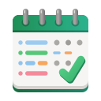
</p>

<h1 align="center">Todav</h1>

<p align="center">Tasks and calendar for GNOME and Android, kept in your Nextcloud.</p>

<p align="center">
  <a href="LICENSE"></a>
  <a href="https://github.com/AperteDev/todav/actions/workflows/ci.yml"></a>
  <a href="https://github.com/AperteDev/todav/releases/latest"></a>
  <a href="https://aur.archlinux.org/packages/todav-bin"></a>
  <a href="https://copr.fedorainfracloud.org/coprs/selfref/todav/"></a>
</p>

Todav is a task list and calendar app for the GNOME desktop and Android. Your tasks and events
stay in your own Nextcloud as plain CalDAV, so the Nextcloud Tasks and Calendar web apps, DAVx⁵,
Thunderbird and other CalDAV clients keep seeing the same data. Todav adds fast apps on top: they
work from a local copy, sync in the background and pick up changes from other devices within
seconds.

Todav is developed in my free time. If it keeps your days in order, you can support its
development:

<p align="center">
  <a href="https://ko-fi.com/N5E229GJPZ"></a>
  <a href="https://github.com/sponsors/SelfRef"></a>
  <a href="https://liberapay.com/SelfRef/donate"></a>
</p>

## Screenshots

| Tasks, grouped by category | The month, an event's details |
| --- | --- |
| 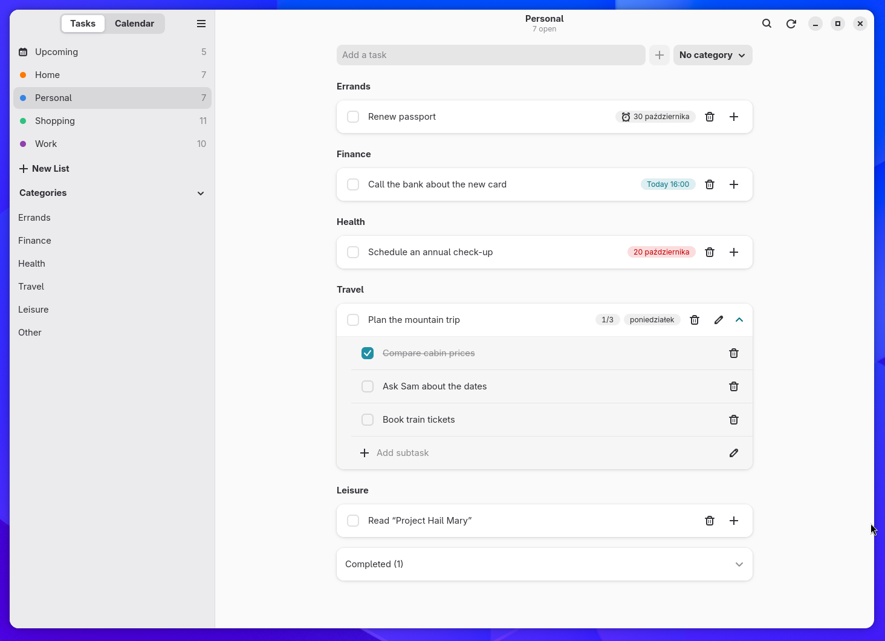 | 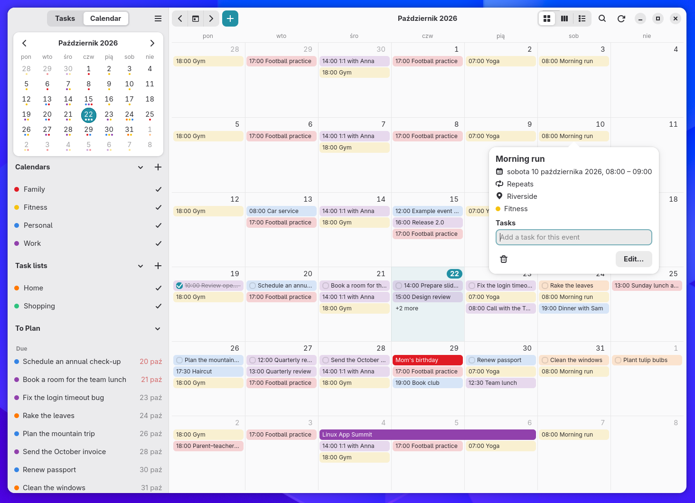 |
| **The week, a time-blocked task** | **Editing an event** |
| 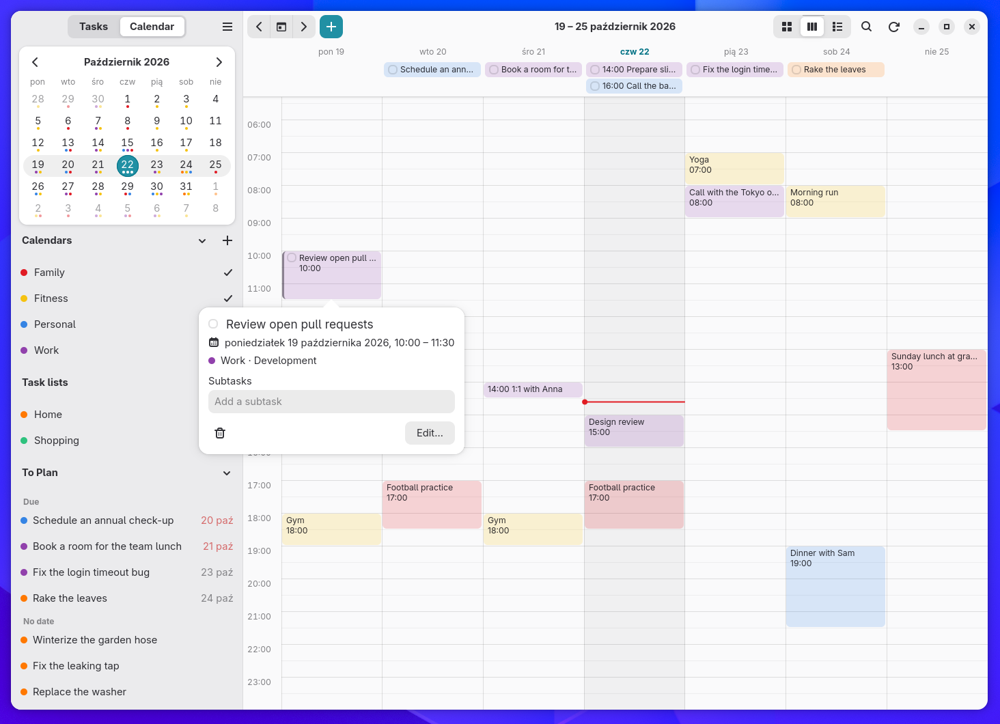 | 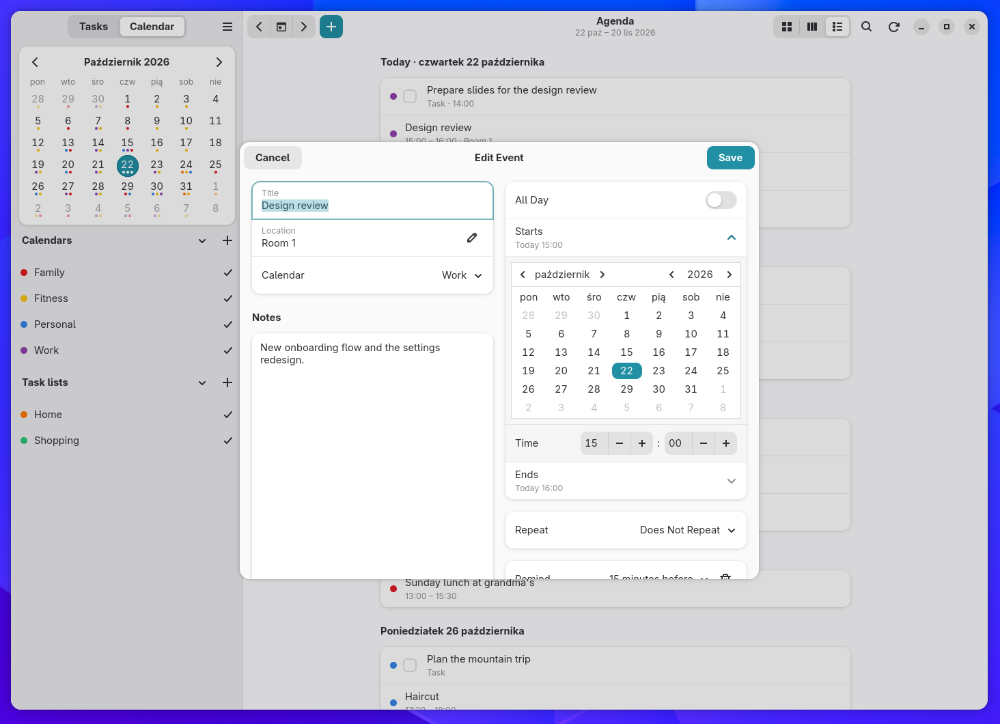 |

<p align="center">
  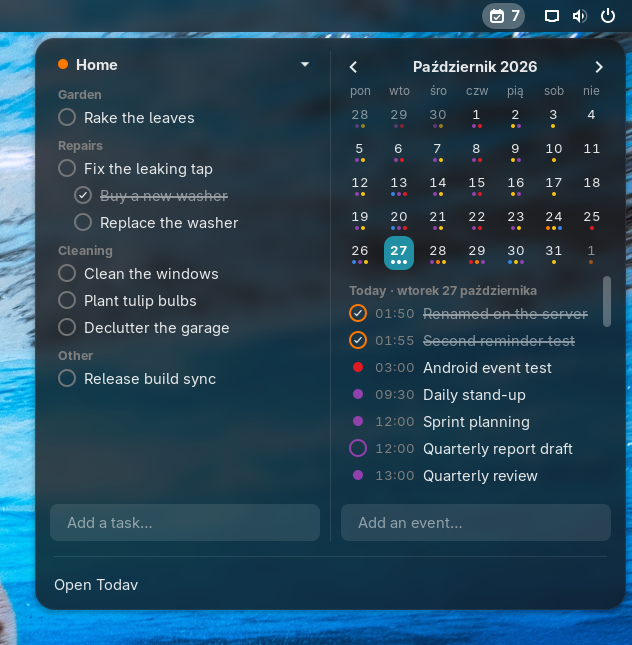
  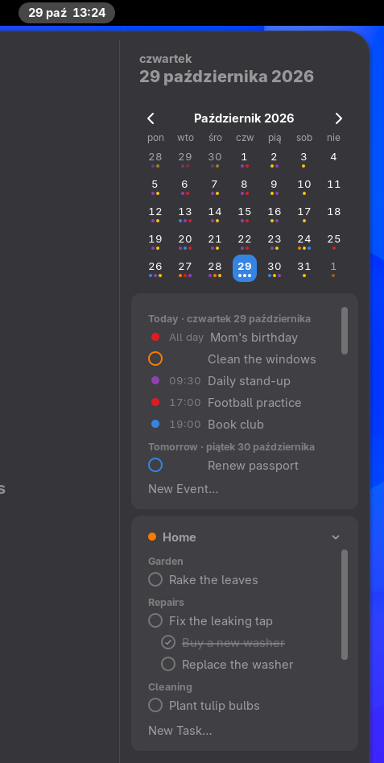
  <br><em>The GNOME Shell extension: its own menu, or in GNOME's clock menu</em>
</p>

**Android**

| Tasks, grouped by category | The week |
| --- | --- |
| 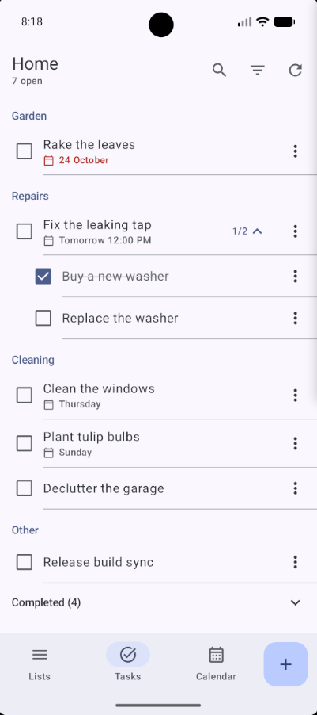 | 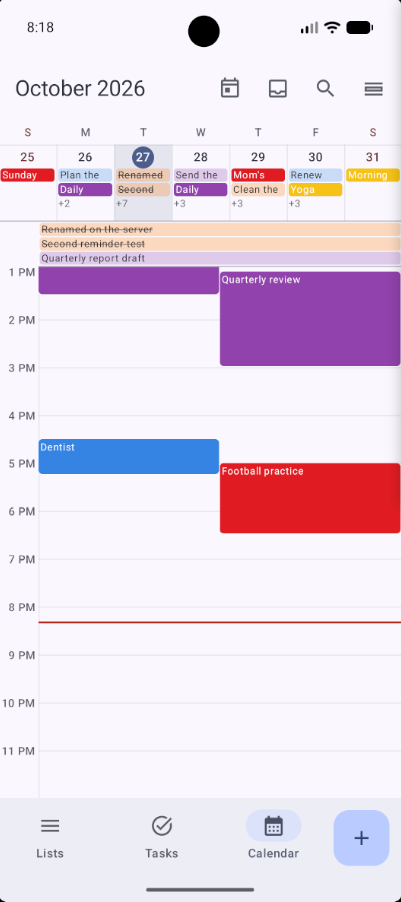 |
| **On an unfolded foldable or a tablet** | **The calendar beside its sidebar** |
| 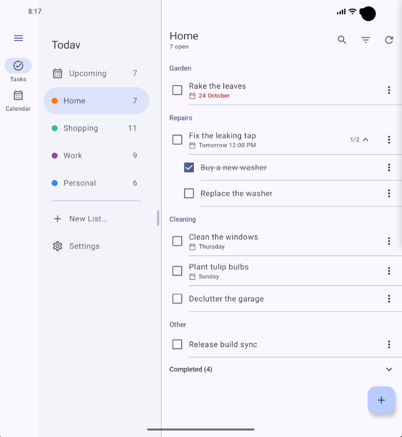 | 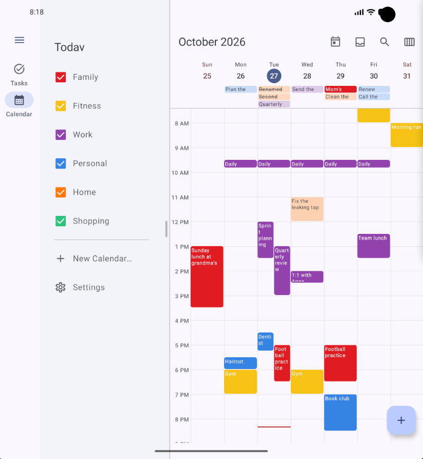 |

<p align="center">
  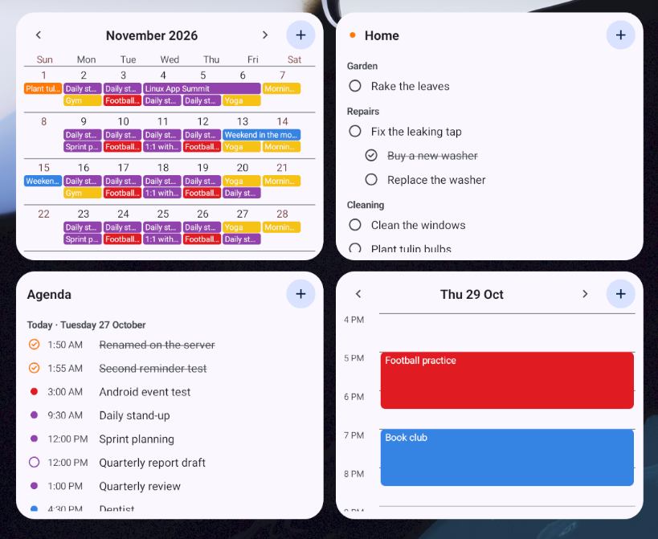
  <br><em>Home-screen widgets</em>
</p>

## Features

- Task lists from your Nextcloud calendars, with categories, subtasks, priorities, due and start
  dates, and reminders as notifications with "Mark as Done".
- A calendar with Month, Week and Agenda views; plan a task by dropping it on an hour or a day.
- Works offline from a local copy; with WebDAV Push and ntfy, changes from other devices show up
  within seconds.
- Several accounts side by side: Nextcloud, Google (its calendars and Google Tasks) and lists
  kept on this device only, with no server at all.
- Sign-in through GNOME Online Accounts, the browser, or a login name and app password.
- A GNOME Shell extension: your tasks, the month and the agenda by the clock, or in GNOME's
  clock menu.
- An Android app with home-screen widgets and push through UnifiedPush, without Google services.
- Preferences synced between your devices.

All of what Todav does, and what it will, is listed in [FEATURES.md](docs/FEATURES.md).

## Getting started

Todav needs GNOME 49 or newer, or Android 10 or newer. The GNOME Shell extension is optional;
it runs on GNOME 48 too (Debian 13, for instance), with the app installed as a Flatpak.

**Android:** download `todav-<version>.apk` from the
[latest release](https://github.com/AperteDev/todav/releases/latest) and open it on your phone
(allow your browser or file manager to install apps when asked). Later versions install over it.
Coming from 2.0.1 or earlier, which were test builds signed differently each release, uninstall
that one first (lists on the device only are lost; your Nextcloud's sync back). Todav syncs with
your Nextcloud itself; you don't need DAVx⁵ for it. With [Obtainium](https://obtainium.imranr.dev/)
it updates itself from the releases.

<p align="center">
  <a href="https://github.com/AperteDev/todav/releases/latest"></a>
  <a href="https://apps.obtainium.imranr.dev/redirect?r=obtainium://add/https://github.com/AperteDev/todav"></a>
</p>

**Arch Linux and derivatives** (Manjaro, EndeavourOS, CachyOS…): install from the
[AUR](https://aur.archlinux.org/packages?K=todav) with an AUR helper:

```sh
yay -S todav gnome-shell-extension-todav
```

These build the latest release from source; `todav-bin` and `gnome-shell-extension-todav-bin`
install the prebuilt release instead, and `todav-git` and `gnome-shell-extension-todav-git` build
the latest commit.

**Fedora** 43 and newer: install from [COPR](https://copr.fedorainfracloud.org/coprs/selfref/todav/):

```sh
sudo dnf copr enable selfref/todav
sudo dnf install todav gnome-shell-extension-todav
```

**Other distributions:** download a package from the
[latest release](https://github.com/AperteDev/todav/releases/latest):

```sh
# Flatpak, on any distribution (the GNOME runtime comes from Flathub), plus the extension
flatpak install --user dev.aperte.Todav.flatpak
gnome-extensions install todav@aperte.dev.shell-extension.zip

# Ubuntu 26.04 and newer: the app with the extension
sudo apt install ./todav_<version>_amd64.deb

# Other distributions: the same files to unpack into /
sudo tar -xzf todav-<version>-x86_64.tar.gz -C /
```

<p align="center">
  <a href="https://extensions.gnome.org/extension/11473/todav-tasks-calendar/"></a>
</p>

The extension is also on [extensions.gnome.org](https://extensions.gnome.org/extension/11473/todav-tasks-calendar/),
a second way to get it. It suits the Flatpak app, which doesn't include it; the packages above
install it with the app. It still needs the Todav app.

Log out and back in, then turn the extension on in Extensions (or
`gnome-extensions enable todav@aperte.dev`). Or [build and install](#building-and-installing)
Todav from source. Then:

1. Open Todav and sign in to your Nextcloud: pick a GNOME Online Accounts account, sign in in the
   browser, or use a login name and app password. Or choose "On This Device Only" to start
   without a server.
2. Your task lists and calendars appear, and new ones can be created from the sidebar. More
   accounts can be added in Preferences → Accounts.
3. For instant updates, install the [DAV Push](https://apps.nextcloud.com/apps/dav_push) app on
   your Nextcloud and enter your ntfy server in Preferences → Accounts → Push. Each account's
   page there shows whether its server has DAV Push and whether it works. On Android, install a
   UnifiedPush distributor such as the [ntfy app](https://f-droid.org/packages/io.heckel.ntfy/)
   instead.

## Roadmap

Todav is under active development: what is planned is listed in
[FEATURES.md](docs/FEATURES.md#planned), with the details in [ROADMAP.md](docs/ROADMAP.md).

Ideas, questions and bug reports are welcome: open an
[issue](https://github.com/AperteDev/todav/issues). See [CONTRIBUTING.md](docs/CONTRIBUTING.md) before
working on a pull request.

## Translations

Todav speaks English, Polish, German, French, Spanish, Italian and Brazilian Portuguese, and
follows your GNOME or Android language. English and Polish are reviewed; the others are first
drafts, so corrections from native speakers are very welcome. Missing your language? Ask for it in an
[issue](https://github.com/AperteDev/todav/issues/new?template=translation.yml), or translate it
yourself (see [CONTRIBUTING.md](docs/CONTRIBUTING.md#translations)).

## Development

### Tested setup

Todav is developed and tested mainly on this setup:

- **Nextcloud** with its built-in CalDAV server (the Tasks and Calendar apps are optional, but
  handy as web fallbacks).
- **GNOME** 49 to 51, with the app (GTK 4 + libadwaita) and the optional GNOME Shell extension
  (which runs on 48 too).
- **Android** 15 to 17 on phones and foldables (the emulator), with the ntfy app as the
  UnifiedPush distributor.
- Optionally, for instant updates: the [DAV Push](https://github.com/bitfireAT/nc_ext_dav_push)
  Nextcloud app (`dav_push`) and an [ntfy](https://ntfy.sh) server.

Todav speaks standard CalDAV, but other servers and desktops are untested for now.

### Building and installing

**Dependencies:** Rust (stable), GTK 4.14+, libadwaita 1.8+, libsecret, SQLite, `blueprint-compiler`,
`glib-compile-resources` (GLib) and gettext's `msgfmt`.

```sh
# The app: binary, desktop file, icons, D-Bus activation and autostart in ~/.local
make -C todav/linux install

# The GNOME Shell extension (log out and back in, then enable it in Extensions)
make -C todav/gnome-extension install
```

A Flatpak manifest is included too: `make -C todav/linux flatpak` (needs `flatpak-builder`).
For Fedora, `todav/linux/rpm/todav.spec` builds the app and the extension as RPMs; COPR builds
it with `.copr/Makefile`, which also works locally:

```sh
make -f .copr/Makefile srpm outdir=$PWD/target/rpm spec=$PWD/todav/linux/rpm/todav.spec
```

**Android:** the Gradle project in `todav/android` builds the Rust core with `cargo-ndk`. It needs
`rustup`, `cargo-ndk`, JDK 21, `gettext` and `unzip`; `sdk.sh` sets up the Android SDK and an
emulator in `~/Android/Sdk` with the versions in `gradle.properties`:

```sh
make -C todav/android setup   # the SDK, the NDK and the emulator
make -C todav/android build   # debug APKs in todav/android/app/build/outputs/apk/debug/
make -C todav/android run     # built for the emulator, installed and started
```

Every push is checked and packaged by [CI](.github/workflows/ci.yml); releases are made by the
manual [Release](.github/workflows/release.yml) workflow and listed in the
[changelog](docs/CHANGELOG.md).

## License

[GPL-3.0-or-later](LICENSE)
