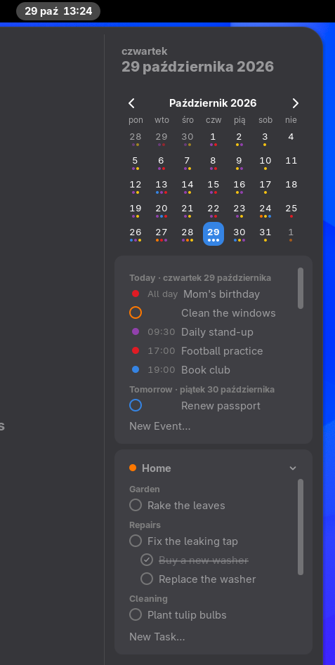
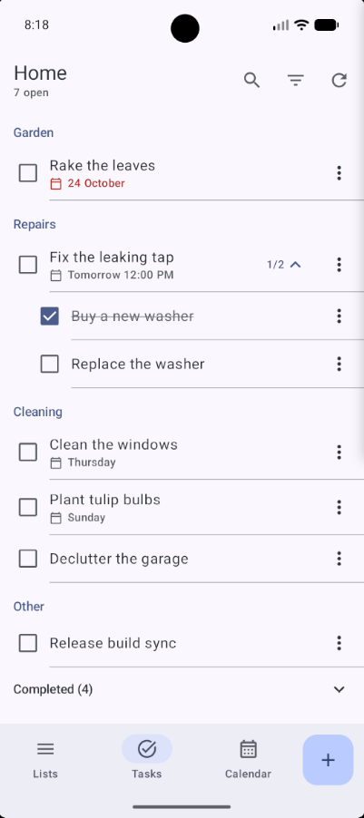
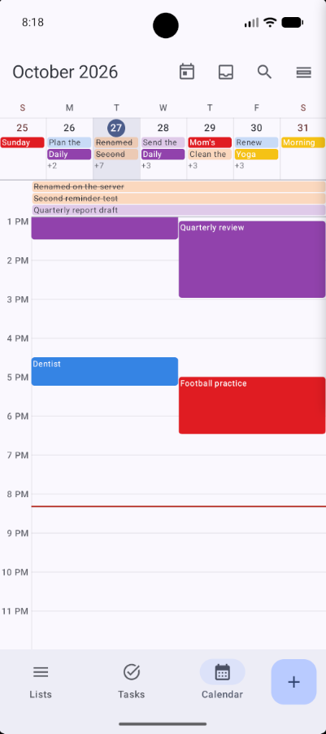
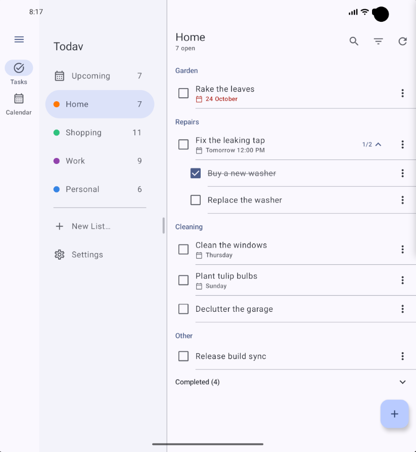
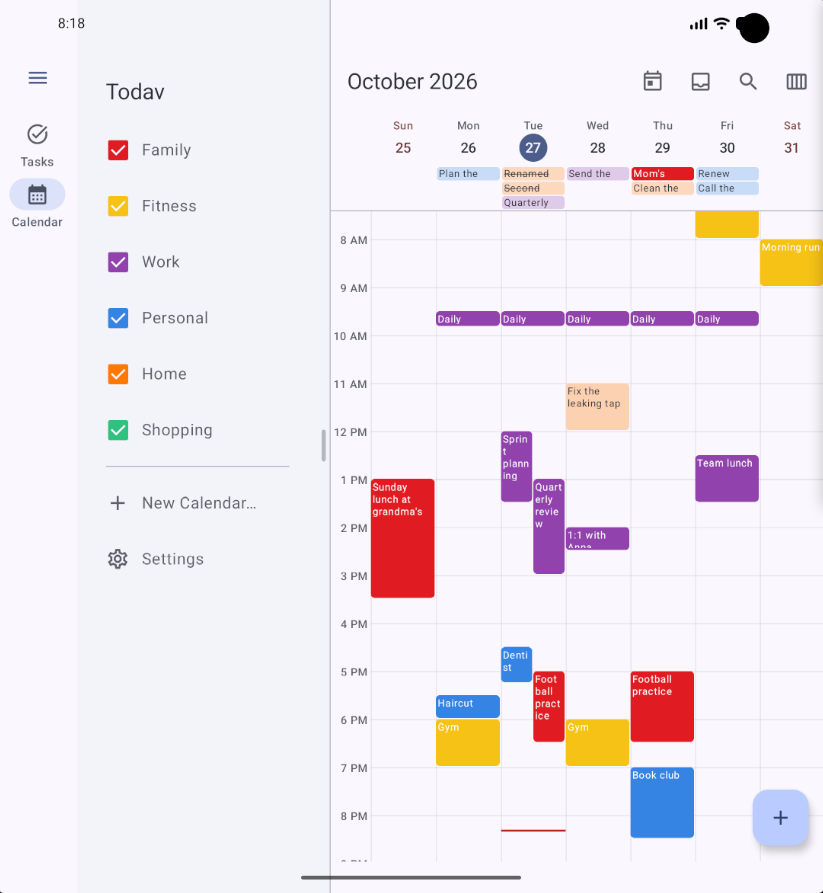
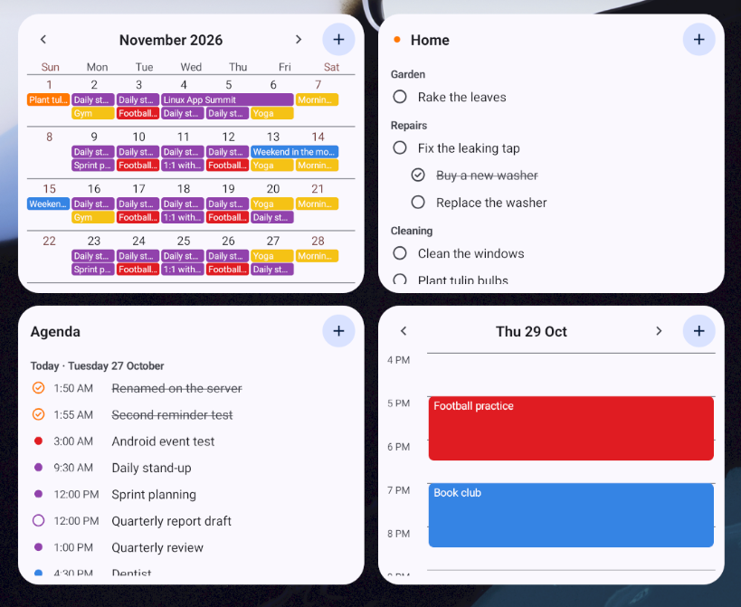

<p align="center">
  
</p>

<h1 align="center">Todav</h1>

<p align="center">Tasks and calendar for GNOME and Android, kept in your Nextcloud.</p>

<p align="center">
  <a href="https://github.com/AperteDev/todav/actions/workflows/ci.yml"></a>
</p>

Todav is a task list and calendar app for the GNOME desktop and Android. Your tasks and events
stay in your own Nextcloud as plain CalDAV, so the Nextcloud Tasks and Calendar web apps, DAVx⁵,
Thunderbird and other CalDAV clients keep seeing the same data. Todav adds fast apps on top: they
work from a local copy, sync in the background and pick up changes from other devices within
seconds.

Todav is developed in my free time. If it keeps your days in order, you can support its
development:

[](https://ko-fi.com/N5E229GJPZ)
[](https://github.com/sponsors/SelfRef)
[](https://liberapay.com/SelfRef/donate)

## Screenshots

| Tasks, grouped by category | The month, an event's details |
| --- | --- |
|  |  |
| **The week, a time-blocked task** | **Editing an event** |
|  |  |

<p align="center">
  
  
  <br><em>The GNOME Shell extension: its own menu, or in GNOME's clock menu</em>
</p>

**Android**

| Tasks, grouped by category | The week |
| --- | --- |
|  |  |
| **On an unfolded foldable or a tablet** | **The calendar beside its sidebar** |
|  |  |

<p align="center">
  
  <br><em>Home-screen widgets</em>
</p>

## Features

**Tasks**

- Task lists from your Nextcloud calendars; create, rename, recolour and delete lists.
- Categories (CalDAV `CATEGORIES`), shown as groups or tags, with a category filter in the
  sidebar.
- Subtasks, nested to any depth, manual order by drag and drop (the same order Nextcloud Tasks uses), sorting by
  creation date, due date or priority from the task page, and notes.
- Priority on a star, coloured by its level and set from its menu, as Nextcloud Tasks stars
  tasks; an Important page with the high-priority tasks of every list.
- Pinned tasks stay at the top of their list.
- Move a task, with its subtasks, to another list: drop it on the list in the sidebar or pick
  the list in the task dialog.
- Due dates with optional times, start times, and several reminders per task, before or after
  its due date or its start, delivered as desktop notifications with "Mark as Done".
- An Upcoming page across all lists: Overdue, Today, Tomorrow, the coming days and later.
- Search across all lists (ignores accents) and undo with Ctrl+Z.

**Calendar**

- Month, Week and Agenda views of your Nextcloud calendars, with a sidebar month and show/hide per
  calendar.
- Create, edit, move and delete events, including recurring ones (this occurrence, this and the
  following, or all), with reminders.
- Drag and drop:
  - **Plan** a task from the "To Plan" list in the sidebar by dropping it on an hour of the week
    view (it gets a time slot) or on a day (it becomes due that day). A preview shows where it
    lands and the times, in 15-minute steps.
  - **Move** events and planned tasks to another hour or day; for a repeating event Todav asks
    whether to move this occurrence, the following ones or all of them.
  - **Resize** a block in the week view by dragging its top or bottom edge to change when it
    starts or ends.
  - **Unplan** a task by dropping it back on "To Plan".
  - **Change calendar** by dropping an event on another calendar in the sidebar (a task on
    another list).
- Click an event or task for its details (a task's subtasks, an event's tasks, both addable
  there); double-click to edit it.
- Tasks linked to events: an event lists its tasks, and a task shows its event.

**GNOME integration**

- Sign in through **GNOME Online Accounts**, in the browser (Nextcloud Login Flow) or with a login
  name and app password. Passwords stay in the system keyring.
- **Several accounts** side by side: Nextcloud accounts on one server or more, a Google account
  from GNOME Online Accounts (its calendars' events and its **Google Tasks**, which keep a
  title, notes, a due date and subtasks), and lists kept on this device. Each can be switched off (its lists are hidden, nothing is deleted) and the
  sidebar groups lists by account, in the order you drag them into.
- Runs in the background: closing the window hides it, and reminders and sync keep working.
  Starts with your session.
- A **GNOME Shell extension**: an icon by the clock, with a count of your choice (open tasks,
  tasks due, important tasks or today's events), and a menu showing a task list, a month calendar
  and the agenda of the coming days (or of a day clicked in the month); it can add tasks and
  events and opens the app where you click. Or put it all in GNOME's clock menu, in place of its
  calendar and events, with one click in Preferences → Extension, or each part where you like.
- Can be the system's calendar app (Preferences → General), which the date in GNOME's clock menu
  opens.
- Follows the system style (light/dark), adaptive layout for narrow windows and touchscreens,
  keyboard shortcuts.

**Sync**

- Local-first: everything reads and writes a local database, so the app never waits for the
  network and keeps working offline; changes are sent when the server is reachable again.
- Push: with WebDAV Push and ntfy, changes made elsewhere show up within seconds. Without them,
  Todav checks every minute while its window is focused and every 30 minutes otherwise.
- Conflicts resolve per task, and a task ticked done on any device stays done.
- Properties Todav does not understand are kept as they are, so other clients' data survives.
- Your preferences sync between devices through `.config/todav/settings.json` in the Nextcloud
  Files of the account you pick (or none; accounts and server addresses stay on each device).
  The order of each list's categories is kept next to it, in each account's `todav/config.json`.

**On this device only**

- Use Todav without a server: choose "On This Device Only" when it starts, and your task lists
  and calendars stay on this computer.
- With a Nextcloud account too, add "On This Device" in Preferences → Accounts to keep some
  lists and calendars off the server, next to the synced ones.

**Android**

- The same tasks and calendar as on the desktop, in Material 3 Expressive: a navigation bar on
  phones, a rail and a resizable sidebar on unfolded foldables and tablets.
- Swipe actions of your choice (complete, star, pin or delete with Undo), drag and drop to
  reorder tasks, make subtasks or change a category, and to plan tasks into the hours of the
  calendar.
- Month, Week, Work Week, 3 Days, Day and Agenda views.
- Home-screen widgets: a task list, the month, the agenda, a day's hours and a month planner,
  each with an add button and colours of your choice.
- Push through [UnifiedPush](https://unifiedpush.org) (with the ntfy app, for instance), no
  Google services; reminders with "Mark as Done", "New Task" from the launcher, sharing text as
  a task, and keyboard shortcuts.
- Signs in with the browser or an app password; with the Nextcloud app installed, its accounts
  fill in the server and login name.
- Syncs with your Nextcloud by itself: it does not need DAVx⁵ (or the Nextcloud app). If you
  keep DAVx⁵ for other apps, both can sync the same Nextcloud side by side.
- System Calendars shows the calendars of the phone's other accounts (Google, Exchange,
  DAVx⁵…) read-only. It marks the ones Todav already syncs itself, such as DAVx⁵'s copies of
  your Nextcloud calendars; turned on, their events would show twice.

## Getting started

Todav needs GNOME 49 or newer, or Android 10 or newer. The GNOME Shell extension is optional.

**Android:** download `todav-<version>.apk` from the
[latest release](https://github.com/AperteDev/todav/releases/latest) and open it on your phone
(allow your browser or file manager to install apps when asked). Later versions install over it.
Coming from 2.0.1 or earlier, which were test builds signed differently each release, uninstall
that one first (lists on the device only are lost; your Nextcloud's sync back). Todav syncs with
your Nextcloud itself; you don't need DAVx⁵ for it.

**Arch Linux and derivatives** (Manjaro, EndeavourOS, CachyOS…): install from the
[AUR](https://aur.archlinux.org/packages?K=todav) with an AUR helper:

```sh
yay -S todav gnome-shell-extension-todav
```

These build the latest release from source; `todav-bin` and `gnome-shell-extension-todav-bin`
install the prebuilt release instead, and `todav-git` and `gnome-shell-extension-todav-git` build
the latest commit.

**Fedora** 43 and newer: install from [COPR](https://copr.fedorainfracloud.org/coprs/selfref/todav/):

```sh
sudo dnf copr enable selfref/todav
sudo dnf install todav gnome-shell-extension-todav
```

**Other distributions:** download a package from the
[latest release](https://github.com/AperteDev/todav/releases/latest):

```sh
# Flatpak, on any distribution (the GNOME runtime comes from Flathub), plus the extension
flatpak install --user dev.aperte.Todav.flatpak
gnome-extensions install todav@aperte.dev.shell-extension.zip

# Ubuntu 26.04 and newer: the app with the extension
sudo apt install ./todav_<version>_amd64.deb

# Other distributions: the same files to unpack into /
sudo tar -xzf todav-<version>-x86_64.tar.gz -C /
```

Log out and back in, then turn the extension on in Extensions (or
`gnome-extensions enable todav@aperte.dev`). Or [build and install](#building-and-installing)
Todav from source. Then:

1. Open Todav and sign in to your Nextcloud: pick a GNOME Online Accounts account, sign in in the
   browser, or use a login name and app password. Or choose "On This Device Only" to start
   without a server.
2. Your task lists and calendars appear, and new ones can be created from the sidebar. More
   accounts can be added in Preferences → Accounts.
3. For instant updates, install the [DAV Push](https://apps.nextcloud.com/apps/dav_push) app on
   your Nextcloud and enter your ntfy server in Preferences → Accounts → Push. Each account's
   page there shows whether its server has DAV Push and whether it works. On Android, install a
   UnifiedPush distributor such as the [ntfy app](https://f-droid.org/packages/io.heckel.ntfy/)
   instead.

## Roadmap

Todav is under active development. Planned (details in [ROADMAP.md](docs/ROADMAP.md)):

- **Advanced notifications**, configurable
- **Advanced search, filtering and sorting**
- **Settings per list and calendar**, such as how its completed tasks show
- **Export** of lists and calendars to iCalendar files
- **More services** besides Nextcloud
- **Google Tasks on Android**, with a Google sign-in of its own
- **Google Play and F-Droid** for the Android app
- **Pebble app**, through the Android app
- **Windows app**

Ideas, questions and bug reports are welcome: open an
[issue](https://github.com/AperteDev/todav/issues). See [CONTRIBUTING.md](docs/CONTRIBUTING.md) before
working on a pull request.

## Translations

Todav speaks English, Polish, German, French, Spanish, Italian and Brazilian Portuguese, and
follows your GNOME or Android language. English and Polish are reviewed; the others are first
drafts, so corrections from native speakers are very welcome. Missing your language? Ask for it in an
[issue](https://github.com/AperteDev/todav/issues/new?template=translation.yml), or translate it
yourself (see [CONTRIBUTING.md](docs/CONTRIBUTING.md#translations)).

## Development

### Tested setup

Todav is developed and tested mainly on this setup:

- **Nextcloud** with its built-in CalDAV server (the Tasks and Calendar apps are optional, but
  handy as web fallbacks).
- **GNOME** 49 to 51, with the app (GTK 4 + libadwaita) and the optional GNOME Shell extension.
- **Android** 15 to 17 on phones and foldables (the emulator), with the ntfy app as the
  UnifiedPush distributor.
- Optionally, for instant updates: the [DAV Push](https://github.com/bitfireAT/nc_ext_dav_push)
  Nextcloud app (`dav_push`) and an [ntfy](https://ntfy.sh) server.

Todav speaks standard CalDAV, but other servers and desktops are untested for now.

### Building and installing

**Dependencies:** Rust (stable), GTK 4.14+, libadwaita 1.8+, libsecret, SQLite, `blueprint-compiler`,
`glib-compile-resources` (GLib) and gettext's `msgfmt`.

```sh
# The app: binary, desktop file, icons, D-Bus activation and autostart in ~/.local
make -C todav/linux install

# The GNOME Shell extension (log out and back in, then enable it in Extensions)
make -C todav/gnome-extension install
```

A Flatpak manifest is included too: `make -C todav/linux flatpak` (needs `flatpak-builder`).
For Fedora, `todav/linux/rpm/todav.spec` builds the app and the extension as RPMs; COPR builds
it with `.copr/Makefile`, which also works locally:

```sh
make -f .copr/Makefile srpm outdir=$PWD/target/rpm spec=$PWD/todav/linux/rpm/todav.spec
```

**Android:** the Gradle project in `todav/android` builds the Rust core with `cargo-ndk`. It needs
`rustup`, `cargo-ndk`, JDK 21, `gettext` and `unzip`; `sdk.sh` sets up the Android SDK and an
emulator in `~/Android/Sdk` with the versions in `gradle.properties`:

```sh
make -C todav/android setup   # the SDK, the NDK and the emulator
make -C todav/android build   # debug APKs in todav/android/app/build/outputs/apk/debug/
make -C todav/android run     # built for the emulator, installed and started
```

Every push is checked and packaged by [CI](.github/workflows/ci.yml); releases are made by the
manual [Release](.github/workflows/release.yml) workflow and listed in the
[changelog](docs/CHANGELOG.md).

## License

[GPL-3.0-or-later](LICENSE)
