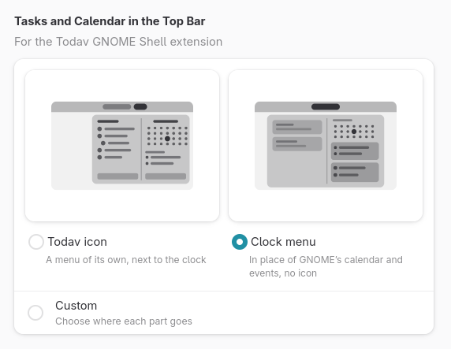

# Changelog

All notable changes to this project will be documented in this file.

The format is based on [Keep a Changelog](https://keepachangelog.com/en/1.1.0/),
and this project adheres to [Semantic Versioning](https://semver.org/spec/v2.0.0.html).

## [Unreleased]

### Added

- Google Tasks in the Google account (Linux, through GNOME Online Accounts): its task lists show
  next to its calendars and sync with Google, checked every minute while the window is focused
  and every 30 minutes otherwise. Task lists can be added, renamed and deleted there; their
  colours stay on each device. Google keeps a task's title, notes, done, a due date without a
  time, subtasks and order only, so the edit dialog offers just those, rows have no star or
  pin, and the calendar plans these tasks onto days, not into hours.
- Fedora packages on COPR (`selfref/todav`), built with each release.

### Fixed

- A task reminder whose time had already passed when it was set (a task due in 10 minutes,
  reminded 15 minutes before) now goes off at once, instead of never, while the task is still
  ahead.
- Android: the task page showed a task's reminders as a long custom time span, and saving the
  task moved them years ahead; it shows and keeps them as set now.

## [2.2.0] - 2026-10-29

### Added

- Checking off tasks outside the app, off by default: a task's circle completes or reopens it
  in the GNOME extension (Preferences → Extension → Tasks → Check off tasks; in the task list
  and the agenda) and in Android's task and agenda widgets (each widget's settings → Check Off
  Tasks). Subtasks follow as Settings → Tasks say, when they would be asked about: then they
  stay as they are.
- A sort button next to Search on the task page picks the task order. Settings → Tasks → Sort
  is now Sort at start: the last used (the default, so the order picked last stays), or one the
  app sorts by whenever it opens.
- Linux: a task's context menu in "To Plan" can delete it too (with Undo), next to Edit….
- Settings → General → Default App → Calendar: the system's calendar app, with a button making
  it Todav. On Linux it does so at once (the app opening calendar files, which GNOME takes as
  its calendar app; not in the Flatpak). On Android, which lets no app do that, the system asks
  which app (Todav, then Always); another app's default is cleared first in its "Open by
  default" settings, which the button opens.
- Extension: its parts can go in GNOME's clock menu, the month in place of its calendar and the
  agenda in place of its events, with the task list under them. Preferences → Extension shows
  the two ways with pictures, Todav's icon with its own menu (with fields for adding) or the
  clock menu (with buttons), and Custom for each part (the task list, the month, the agenda) in
  either menu or nowhere. The icon shows only with something in its menu.

  

- Extension: Preferences → Extension → Adding tasks and Adding events: a field (as before), a
  button opening Todav (in the list's field for adding a task, or on a new event on the day
  picked), or none; with the task list, and with the agenda (else the month).
- Extension: Preferences → Extension → Number by the icon: the open tasks of the list shown
  (as before), tasks due today or earlier, important tasks, today's events, or none.
- Extension: Preferences → Extension → Order puts the calendar before the tasks in its own menu
  (on the left in two columns, on top in one).
- Extension: a right click on its icon opens a menu with Open Todav and Preferences (Todav's,
  on the Extension page).

### Changed

- Android: a low month planner widget shows slimmer bars, as Fossify Calendar's, before none.
- Android: a list or calendar held in the sidebar to move it rises off it, with a shadow.
- Android: a task held to move rises as soon as the long press is felt, not once it moves.
- Android: a tap anywhere on the task widget but a task or a button opens its list in the app,
  not only on its name.
- Extension: its icon sits in the middle of the top bar, next to the clock; Preferences →
  Extension → Icon puts it back on the right.
- Extension: a day clicked in the month shows that day in the agenda, and an event added then
  starts on it; a double click opens it in Todav (one click, without the agenda in sight).
- Extension: Preferences → Extension → Open in the editor, for tasks and for events: a task or
  an event clicked (in the task list or the agenda) opens in its editor in Todav, rather than
  in its list or on its day. Off by default.

### Fixed

- Android: "Mark as Done" on a reminder completes the task's subtasks too when Settings → Tasks
  say so (Completing a task with open subtasks: Completes them too), as on Linux.
- Android: the month planner widget's weeks fill it to the bottom, also where the launcher says
  it is smaller than it is.
- Android: a task dragged off the middle of a row, down past it, lands below that row rather
  than staying set to become its subtask.
- Android: in a sorted list, a task dragged over another moves no rows aside (a drop there
  makes it a subtask, highlighting that row, and reorders nothing).
- Linux: a task dragged beside another in a sorted list says why it cannot go there (set Sort
  to Manual), as on Android.

## [2.1.0] - 2026-10-28

### Added

- Linux: Saturdays and Sundays tinted red a little in the calendar's day names and numbers, and
  in the sidebar's month, as on Android.
- Tasks whose subtasks are shown stay so after a restart, on each device.

### Changed

- Linux: the month view scrolls up and down a week at a time, as GNOME Calendar's, by the
  mouse wheel (a week per notch), a touchpad or a touchscreen; the arrows, Today and a day in
  another month scroll there smoothly.
- Android: the month view scrolls up and down a week at a time, as GNOME Calendar's, instead
  of swiping a month sideways; a mouse wheel scrolls it a week per notch, and Today or a day
  in another month scrolls there.
- Android: the month planner widget can be made as low as the month widget; low, it shows
  each week's days with as many bars as fit, down to none.
- Calendar: Ctrl+1 to Ctrl+6 open the views in the menu's order: Month, Week, Work Week,
  3 Days, Day, Agenda (Agenda moves from Ctrl+3 to Ctrl+6).
- Android: pulling a task's details up while adding a subtask goes on in the editor's Add
  Subtask, with what was typed and the cursor; back down, the text is still there.

### Fixed

- Android: a widget resized on the home screen is laid out for its new size at once, not only
  when it next updates.
- Android: Add Subtask in a task's details stays above the keyboard; with many subtasks it was
  hidden under it.
- Android: the arrows of the calendar widgets turn the month or day again; in release builds
  they did nothing.

## [2.0.4] - 2026-10-28

### Added

- Linux: About shows when a newer stable version is out on GitHub, with a link to its release.

## [2.0.3] - 2026-10-28

### Changed

- Flatpak: Todav no longer asks for access to the system keyring; it keeps its passwords
  through the Secret portal, as it already did.

## [2.0.2] - 2026-10-28

### Changed

- Android: the APK in the releases is signed with Todav's own key, so later versions install
  over it. Coming from 2.0.1 or earlier, uninstall the old one first, one last time.

## [2.0.1] - 2026-10-28

### Fixed

- Android: Todav is in English when English comes first in the system's languages, not in the
  next language it has a translation for.

## [2.0.0] - 2026-10-28

### Added

- Linux: Todav can be the system's calendar app (Settings → Apps → Default Apps → Calendar): it
  opens iCalendar files (`.ics`), whose events and tasks go into the calendar and task list
  picked for them; an item already there is replaced.
- Android: Todav can be the calendar other apps and the system open: at a time or an event of
  the system's calendars (clocks, At a Glance: their day), for other apps' "Add to calendar" (a
  new event with what they give), and for iCalendar files opened or shared (imported, as on
  Linux). Copy Link on a task's page and in a task's or an event's details gives a `todav://`
  link that opens it.
- Android: "New Event" next to "New Task" on the launcher icon, a Quick Settings tile for a new
  task, and Snooze on reminders (back in ten minutes).
- Linux: open tasks and events whose titles hold what is typed show in the Activities overview's
  search; one opens on its list or day, the app's heading searches its tasks in Todav.
- Linux: Copy Link in a task's or an event's dialog and in their details on the calendar puts
  a `todav://` link on the clipboard; pasted elsewhere (notes, a chat), it opens the item in
  Todav: a task on its list, an event on its day.
- Linux: Google calendars, through a Google account in GNOME Online Accounts: their events
  show, sync and can be edited, and the calendars renamed and recoloured; their order stays on
  this device. Google keeps no task lists, and calendars are added and deleted in Google
  Calendar. Only Nextcloud is fully supported, as adding one says; one whose sign-in gave no
  access to the calendars is not added, with what to do instead.
- Android: System Calendars, on the welcome page and in Settings → Accounts → Add Account, shows
  the calendars of the device's own accounts (Google, Exchange, DAVx⁵…), read-only. None is shown
  at first; each is turned on in the account's page, and changes to them show up at once.
  One Todav already syncs itself (DAVx⁵'s copy of a Nextcloud calendar, say) is marked "Already
  in Todav", as its events would show twice. With nowhere to add a list, calendar, task or event (only these calendars), the add buttons
  are not shown.
- A read-only calendar's events can no longer be changed, rather than the server refusing the
  change later; on Android their details no longer offer Edit and Delete.
- Android: a full Material 3 Expressive app. Tasks and Calendar switched by a navigation bar on
  phones and a rail on wider screens, whose menu button shows the lists and calendars: a page
  of its own on phones, a sidebar that can be hidden and resized on unfolded foldables and tablets; a task page with everything the Linux edit
  dialog has; swipe actions picked in Settings for each direction (complete, star, pin or
  delete with Undo); drag tasks to reorder
  them, make them subtasks or change their category; month, week and agenda views where events
  and tasks move by dragging; an event editor with repeating events; "To Plan" for putting tasks
  into hours of the week; search; settings and accounts; reminders; push through UnifiedPush;
  "New Task" from the launcher; adding shared text as a task; keyboard shortcuts.
- Android: home-screen widgets, read-only as the GNOME extension: a task list (or Upcoming,
  Important) by category with its subtasks, the month with a dot per calendar on each day, the
  coming week's agenda, a day's hours, and a month planner with bars across the days. A task or
  an event opens in its editor (on the month planner, the day tapped), a month's or day's title
  in the calendar. Each has an add button
  and settings (its list, or calendars other than those shown in the app; its add button), in
  the launcher's menu of the widget and in Settings → Widgets, which also sets their colours (the
  system's, or a background and a text colour for light and dark), the background's opacity, the
  corners' radius and a settings button on each widget.
- Android: Saturdays and Sundays tinted red a little in the calendar's day names and numbers, and
  in the month widgets'.
- Android: a launcher icon of its own, the calendar page filling whatever shape the launcher gives
  icons, with a themed version; the app opens on it over the system's accent colour, light or
  dark with it.
- Android: About Todav in Settings has a Support section with the Ko-fi, GitHub Sponsors and
  Liberapay links, as About on Linux.
- Android: an account of the Nextcloud app on the device fills in the server and login name
  of a sign-in.
- Android: each release has an APK, a test build until Google Play and F-Droid: uninstall the
  previous one before installing the next.
- Calendar: Work Week, 3 Days and Day views. Work Week shows the days picked in Preferences
  (Monday to Friday at first); 3 Days moves a day at a time; Day shows its
  week above the hours. Ctrl+4, Ctrl+5 and Ctrl+6 open them. On Linux the views are now picked
  from a menu.
- Calendar: an event's or a task's title can be changed right in its details popover: click it,
  type, press Enter.
- Lists and calendars can be put in any order by dragging them in the sidebar, within their
  account; with Nextcloud the order is shared with its Calendar and Tasks apps and other
  devices, lists on this device keep theirs here. On Android, hold a list, then drag it.
- Linux: the sidebar can be hidden with the button at the start of the header or F9; in a
  narrow window it opens over the content instead of in place of it.

### Changed

- Calendar: clicking a task in "To Plan" says how to plan it: drag it onto the calendar;
  right-clicking it offers Edit….
- Calendar: in the agenda, as in the GNOME extension, a task is a ring in its list's colour, with
  a tick when done, and an event a dot; a task is ticked in its details, not in the agenda.

### Fixed

- Android: signing in with the browser no longer fails with "Login failed" when Android cuts off
  Todav's network while the browser is in front.
- On a new installation, reminders never went off.
- The calendar no longer highlights the first day of a month or week moved to with the arrows
  as if it had been picked.
- Calendar: a task or event dragged over the events of a day lights the day up, as over its
  free space.

## [1.3.1] - 2026-10-26

### Added

- "Completing a task with open subtasks" in Preferences > Tasks: completing a task completes its
  open subtasks too (the default, as in Nextcloud Tasks; reopening a subtask then reopens its
  task), leaves them open, or asks each time.
- Reopening a task with completed subtasks asks whether they reopen too.
- "Edit titles in place" in Preferences > Tasks: a click on a task's title with a mouse or
  touchpad edits it right in the list. Off by default.
- When Todav is updated while it runs, it restarts into the new version by itself if its window
  is closed, and otherwise offers Restart in a banner.

### Fixed

- The open subtasks of a completed task stay under it among the open tasks instead of showing
  as top-level tasks.
- Undoing a change while a sync was uploading it no longer gets the change back from the server:
  a task reopened that way was completed again a moment later.

## [1.3.0] - 2026-10-26

### Added

- Several accounts side by side: more Nextcloud accounts (through GNOME Online Accounts or
  signed in in Todav, on the same server or others) and the lists kept on this device, each an
  account in Preferences → Accounts. Add one with Add; each has its own page with its name, its
  connection, Server Status and Remove. The sidebars and list pickers group lists by account,
  in the order set by dragging the accounts by their handles.
- An account can be switched off: its lists and calendars are hidden and stop syncing, nothing
  is deleted.
- "Sync settings with" in Preferences → Accounts picks the account settings sync through, or
  none. The welcome page asks whether to sync settings with the account added there.
- A banner over the tasks and the calendar names an account that is not connected (its password
  is gone from the keyring, or its GNOME Online Accounts account), with Sign In.

### Changed

- The lists on this device are an account of their own ("On This Device"), replacing the
  "Local lists and calendars" switch; hidden local lists stay hidden, as a switched-off account.
- An account without its password no longer shows the welcome page: its lists stay usable and
  the banner offers to sign in again.
- Signing in to a server offers its three ways as buttons (with the browser, by a copied
  login link, with a password) instead of a button with a menu; while the browser sign-in
  waits, only Cancel shows.
- Signing in again keeps the account: a different user is added as another account, and a GNOME
  Online Accounts account and a sign-in in Todav are separate accounts rather than one switch.

### Fixed

- A calendar new on the server, or every calendar of an account just added, gets DAV Push at
  the sync that finds it instead of up to an hour later.

## [1.2.2] - 2026-10-25

### Added

- About has a Support page with where to support Todav's development: Ko-fi, GitHub Sponsors
  and Liberapay.
- Server Status in Preferences → Accounts: the Nextcloud version (or why the server cannot
  be reached, or that it is in maintenance mode), when Todav last synced, and whether DAV
  Push works. Without DAV Push on the server, it says what that means and links to the app
  in the Nextcloud App Store; with it but no ntfy server, it asks for one.
- Extension: a settings button in the Extensions app, opening Todav's Preferences on the
  Extension page.
- An RPM spec for Fedora, with the extension as a separate package, built on COPR from
  `.copr/Makefile`.

### Changed

- Todav uses the system's SQLite library instead of a built-in copy; packages now depend on it.
- The app's store listing has screenshots, release notes and brand colours, and says the GNOME
  Shell extension is optional and installed separately.
- A task's subtask count ("1/4") counts only its own subtasks; deeper ones count on their
  subtask's row.
- Extension: with tasks and calendar side by side, the task list and the agenda take the
  height their column has to spare, so the fields for adding a task and an event line up.

### Fixed

- An account whose password is missing no longer reports "Sync failed: no account
  configured" in local mode; Preferences say it is not connected, and signing in again
  reconnects it.
- Extension: hovering over the menu no longer highlights all of it with themes that style
  hovered menu items, such as Blur my Shell's; only the row under the pointer is highlighted.

## [1.2.1] - 2026-10-25

### Changed

- The app ID is now `dev.aperte.Todav` and the extension's UUID `todav@aperte.dev`.
  Todav moved to [AperteDev](https://github.com/AperteDev/todav) on GitHub.

## [1.2.0] - 2026-10-23

### Added

- Use Todav without an account: "On This Device Only" on the welcome page keeps
  your task lists and calendars on this computer, starting with a task list and
  a calendar.
- "Local lists and calendars" in Preferences → Accounts: keep lists and
  calendars on this device only, next to the synced ones. Turning it off hides
  them; nothing is deleted. New lists and calendars ask where to go.
- The sidebars and the event dialog's calendar picker group lists and calendars
  by where they are kept, those on this device last.
- Move tasks to another list and events to another calendar by dropping them on
  it in the sidebar; a task takes its subtasks along.
- A list picker in the task dialog, to move a task to another list.
- A star on every task, coloured by its priority; its menu sets the priority.
  As in Nextcloud Tasks, a starred task is one of high priority.
- An Important page with the high-priority tasks of every list.
- "Priority, highest first" to sort tasks and subtasks.
- Pin tasks to the top of their list, in a Pinned group (shared with Nextcloud
  Tasks' pins).
- "Stars" and "Pins" in Preferences → Tasks turn either off; pinned tasks stay
  pinned for other apps.
- Nested subtasks, any number of levels deep: a subtask's "+" adds subtasks to
  it, and a task dropped on a "+" moves there with its own subtasks; dropped on
  an "Add subtask" field, it goes where a new subtask would. The task details
  on the calendar list a subtask's subtasks too.

### Changed

- The welcome page asks first how to use Todav (GNOME Online Accounts, a
  Nextcloud server or this device only), then for the account.
- The account, push and sync settings moved to a new Accounts page in
  Preferences.
- Times on the calendar are dimmer than titles and come after them, at the end
  of one-line entries, as in GNOME Calendar.
- Upcoming shows in the sidebar only while some task has a due date, as
  Important does while some task has high priority.

### Fixed

- A task dropped on the "Add a task" field no longer types its internal ID
  into it.

## [1.1.0] - 2026-10-22

### Fixed

- The window opens with the size it had when the app quit, and maximized if it was.

## [1.0.0] - 2026-10-22

### Added

- Tasks and events in your Nextcloud over CalDAV, kept in a local copy: the app
  works offline and syncs in the background, and push through WebDAV Push and
  ntfy brings changes from other devices within seconds.
- Sign in through GNOME Online Accounts, in the browser (Nextcloud Login Flow),
  or with a login name and app password; passwords stay in the keyring.
- Task lists: create, rename, recolour and delete them; categories as groups or
  tags with a sidebar filter; subtasks; manual order by drag and drop, shared
  with Nextcloud Tasks; sorting by due date.
- Tasks: due dates and start times, priority, notes, several reminders each as
  desktop notifications with "Mark as Done", and an Upcoming page across lists.
- A calendar with Month, Week and Agenda views: create, edit, move and delete
  events, repeating ones too (this occurrence, the following or all), with
  reminders. Weeks start on the day your region's formats say.
- Time-blocking: drag tasks from "To Plan" onto an hour or a day, move and
  resize blocks in the week, drop them back to unplan.
- Click an event or task on the calendar for its details, where an event's
  tasks and a task's subtasks can be ticked and added; double-click to edit it
  ("Edit on double click" in Preferences turns this off for instant details).
- Tasks linked to events, and today's events at the top of Upcoming.
- Search across tasks and events, undo with Ctrl+Z, keyboard shortcuts.
- Preferences synced between devices through Nextcloud Files.
- Runs in the background and starts with the session.
- Translations into Polish, German, French, Spanish, Italian and Brazilian
  Portuguese, for the app and the extension. Polish is reviewed; the others are
  first drafts.
- Packages for GNOME 49 and newer: a Flatpak bundle, a `.deb` for Ubuntu 26.04
  and newer, a tarball for other distributions (both with the extension), and
  the extension as a zip.
- A GNOME Shell extension: the open-task count in the top bar, and a menu with a
  task list, a month calendar with dots for what each day holds and the coming
  week's agenda; it adds tasks and events and opens the app where you click.
  Its options are in the app's Preferences. Without the app installed, its
  menu says so and links to the download.

[Unreleased]: https://github.com/AperteDev/todav/compare/v2.2.0...HEAD
[2.2.0]: https://github.com/AperteDev/todav/compare/v2.1.0...v2.2.0
[2.1.0]: https://github.com/AperteDev/todav/compare/v2.0.4...v2.1.0
[2.0.4]: https://github.com/AperteDev/todav/compare/v2.0.3...v2.0.4
[2.0.3]: https://github.com/AperteDev/todav/compare/v2.0.2...v2.0.3
[2.0.2]: https://github.com/AperteDev/todav/compare/v2.0.1...v2.0.2
[2.0.1]: https://github.com/AperteDev/todav/compare/v2.0.0...v2.0.1
[2.0.0]: https://github.com/AperteDev/todav/compare/v1.3.1...v2.0.0
[1.3.1]: https://github.com/AperteDev/todav/compare/v1.3.0...v1.3.1
[1.3.0]: https://github.com/AperteDev/todav/compare/v1.2.2...v1.3.0
[1.2.2]: https://github.com/AperteDev/todav/compare/v1.2.1...v1.2.2
[1.2.1]: https://github.com/AperteDev/todav/compare/v1.2.0...v1.2.1
[1.2.0]: https://github.com/AperteDev/todav/compare/v1.1.0...v1.2.0
[1.1.0]: https://github.com/AperteDev/todav/compare/v1.0.0...v1.1.0
[1.0.0]: https://github.com/AperteDev/todav/releases/tag/v1.0.0
